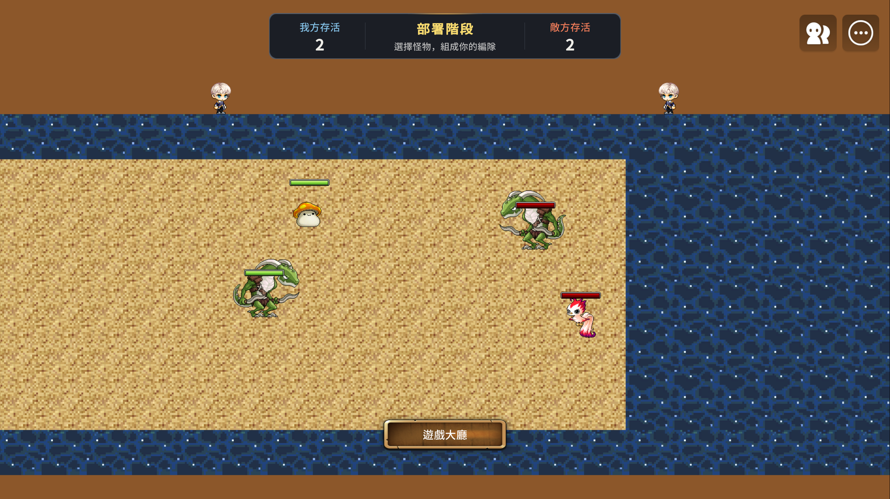
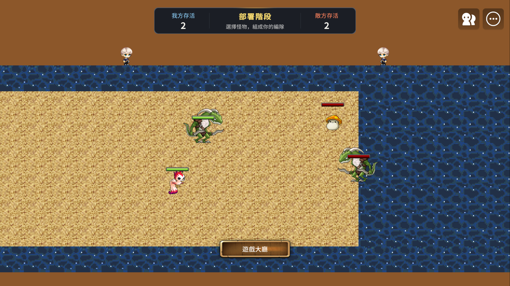
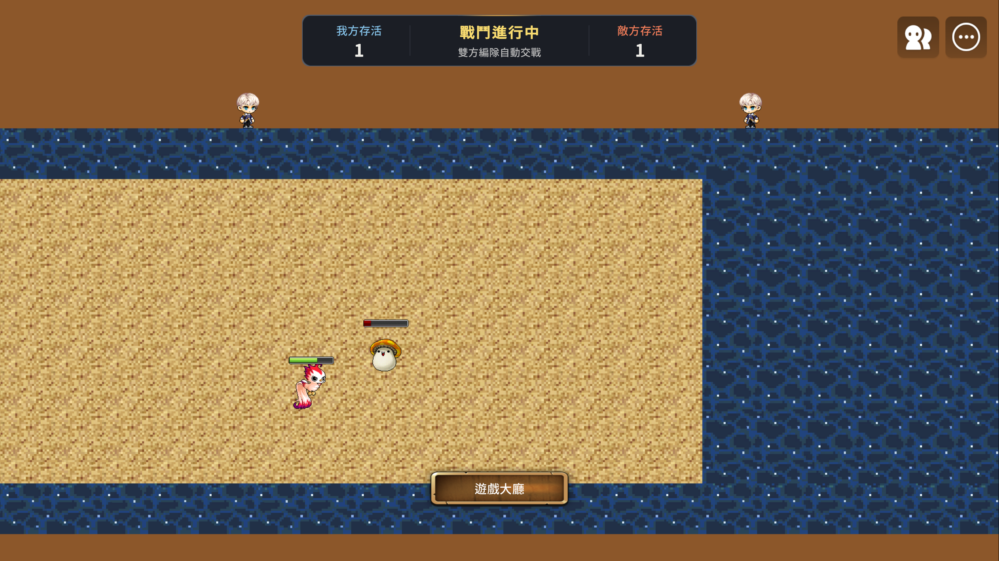

# #36 雙方我方左側視角原型

## 問題與事前判準

正式地圖與預存編隊不變。本票使用 `battleviewprototype` 隔離場景、正式
`BattleSession`、`MonsterData` 與公開 `PrepareBattleForTest` 初始化介面。
取得測試時鐘只用於原子初始化；開戰後釋放，由原生幀驅動自然索敵、移動、命中與結算。

使用不對稱的坦克／戰士與戰士／射手編隊，位置與高度不同。先以本機玩家作
Home，再將同一本機玩家註冊為 Away 重跑，必須實際看到不同的左右呈現。
這是 Maker 身分交換驗證，不是雙真人或跨 WorldInstance 驗收。

PASS 必須同時具備：

- 兩個實際客戶端畫面都在開場顯示我方左、敵方右。
- 來源位置、目標、HP、事件與唯一結果由同一份 BattleSession 決定。
- 顯示代理沒有 Body、Hit、Trigger 或攻擊元件，不修改來源 Transform。
- 移動、面向、攻擊／受擊／死亡動畫、命中特效及傷害數字對應顯示位置。
- 血條滿血可見、比例一致、我方原色、敵方紅色；文字與數字正向。
- 上方兩個角色左右對稱、朝向中央，不參與戰鬥。
- build、runtime 與公開介面探針具備完成證據，離開後清除本機代理。

任何一項缺證據均不可宣告整票 PASS。Camera 文件沒有水平反射 API，
不能將候選 API 當成已驗證能力。#37／#38 維持相依驗收門檻。

## 待辦

- [x] 記錄場景、問題與判準。
- [x] 建立隔離場景與本機顯示代理。
- [x] Maker 驗證兩種身分、自然戰鬥、畫面與清理。
- [x] 程式碼審查及記錄技術結論。

## 驗證結果

2026-10-22，Maker 26.10，PC 1920×1080，基準 commit `1b47358`。

**技術結論：客戶端 bodyless 顯示代理可行。** 同一個 BattleSession 世代 2，
先後將實際本機 UserId 註冊為 Home／Away，兩次都執行真正客戶端呈現與開場探針。
身分交換期間，伺服器 `GetUnitSnapshots()` 完全相同。沒有第二套索敵、傷害或結果模擬。
這是本票允許的本機身分交換實測；對手是 fixture 身分與角色外觀，
不代表兩個真人客戶端、帳號外觀載入或 #31 的跨 instance 驗收。

### 畫面

同一個世代、同一份單位座標，Home 我方為坦克＋戰士，Away 我方為戰士＋射手：





下圖為修正原生影子後的實際交戰畫面，包含受傷血條與兩個上方角色。
短暫命中特效另外由實際 EffectService serial 與目標位置記錄確認。



正向傷害數字 `10` 的較早一輪畫面保留為
[數字取樣](evidence/issue36/away-damage-before-shadow-fix.png)。該歷史取樣尚有原生影子殘留，
不作最終無殘影驗收圖；上述最終開場／交戰圖與探針均在影子修正後重跑。

### Maker 證據

完整的選錄 checkpoint（包含實際代理動畫 RUID、傷害與特效位置）：
[checkpoints.json](evidence/issue36/checkpoints.json)。這是選錄正向證據，不是整份 Console 匯出。

| 項目 | 結果 |
|---|---|
| Refresh／build | 最終 build errors = 0 |
| Home 開場 | `OPENING_PASS localFaction=PLAYER generation=2` |
| 交換身分、權威不變 | `AUTHORITY_UNCHANGED generation=2` |
| Away 開場 | `OPENING_PASS localFaction=ENEMY generation=2` |
| 自然戰鬥 | `NATURAL_PASS result=LOSE localFaction=ENEMY events=139` |
| 伺服器唯一結果 | `SERVER_FINAL_PASS oneResult=1 result=LOSE playerAlive=0 enemyAlive=1` |
| 終局位置、HP、角色 | `FINAL_GEOMETRY_HP_AVATARS_PASS` |
| 離場清理 | `DEPARTURE_CLEANUP_PASS destroyed=6`，清理重跑 runtime errors = 0 |
| 正式 map01 回歸 | `SixVsSixFullBattle PASS`，自然 6v6、唯一 RESULT、終局穩定一秒，runtime errors = 0 |

`LOSE` 是伺服器 Home 的結果，這輪本機為 Away。HUD 存活數同樣依本機身分轉換，
沒有重新計算戰果。原始 sprite 保留播放但 alpha 為零，原血條隱藏，原傷害數字
spawner 與原生 `KinematicbodyComponent.EnableShadow` 在本機停用並於清理時還原；
探針確認代理沒有 Body／Hit／Movement／Trigger。
代理的 SpriteAnimPlayerStartEvent 回報了移動、攻擊、受擊及死亡素材的真實播放。
非坦克命中特效共有 22 次成功建立記錄（serial 非零），目標為 `View_*`。
傷害數字由伺服器已結算的 amount 發送至同一顯示目標，並不從 HP 差推算。

### 測試限制與探索失敗

- 代理由地圖 `OnUpdate` 追隨來源。擊退與 coroutine 取樣跨幀時，最大位置差
  最終量到 0.2514 世界單位；初版 0.2 門檻因此失敗。自然觀察探針明示使用 0.35
  容差，不宣稱逐影格零延遲。終局穩定後位置容差為 0.001，HP 比例容差為 0.0001。
  交戰 HP 檢查容許一次同步／呈現更新的差距，並以終局精確比例補驗。
- 第一版清理探針在離場後重新查地圖，因客戶端已卸載地圖而對 nil 取索引。
  修正為離場前保存六個公開 Entity 參考，再確認它們全數失效，重跑 PASS。
- 最後畫面審查發現原生影子不受 sprite alpha 影響。已本地停用／還原來源的影子，
  補入開場及自然戰鬥斷言，重新擷取畫面；該輪全部 checkpoint 通過且 runtime errors = 0。
- 既有 UIComponent 套件最初有六個 `LEA-4002` 型別快取錯誤。
  強制相關 `.mlua` 的重新匯入後為零；沒有修改套件內容。
- `node --test tests/*.test.cjs`：25 PASS／3 FAIL。三項在基準原碼已不一致：
  Camera 測試期待已移除的 `CameraZoomPercent`；部署測試期待距離 0.6（基準為 0.3）；
  catalog fixture 期待坦克 HP 500（基準 CSV 為 300）。本票未更動這些斷言或數值。
- 原型複製現有非對稱地形，僅反射動態呈現，不反射地形。因此某些反射位置會顯示在
  原地形牆上；代理不碰撞。正式整合必須使用 #37 的中心對稱地形。

## 可重跑程序

1. Maker 停止 Play，Refresh，確認 build 無錯誤。以 `maker_move_map` 開啟
   `battleviewprototype` 後再 Play；只 Refresh 新地圖而未開啟，不足以保證客戶端載入它。
2. 等 `maker_get_context_keys` 回報 `server_main`／`client`。
3. 在 `server_main` 執行 `tests/battle_view_setup_runtime_probe.lua`，等待 `SETUP_PASS`。
4. 在 `client` 執行 `tests/battle_view_runtime_probe.lua`，等待 Home `OPENING_PASS`，擷取畫面。
5. 在 `server_main` 執行 `tests/battle_view_swap_runtime_probe.lua`，等待
   `AUTHORITY_UNCHANGED`。再執行同一個 client 開場探針並擷取 Away 畫面。
6. 在 `client` 執行 `tests/battle_view_observe_runtime_probe.lua`，接著在 `server_main`
   執行下列片段。不要在同一 context 另送腳本覆蓋尚未完成的探針。

```lua
local map = _EntityService:GetEntityByPath('/maps/battleviewprototype')
assert(map:GetComponent('script.BattleSession'):TryStartBattle())
```

7. 等待 `NATURAL_PASS`（上限 100 秒），在 client 執行
   `tests/battle_view_final_runtime_probe.lua`，等待 `FINAL_GEOMETRY_HP_AVATARS_PASS`。
8. 在 client 執行 `tests/battle_view_cleanup_runtime_probe.lua`，接著在 server 執行：

```lua
_TeleportService:TeleportToMapPosition(
    _UserService.UserEntities.Values[1], Vector3(0, 0, 0), 'formationlobby')
```

9. 等待 `DEPARTURE_CLEANUP_PASS`，讀取 runtime／build logs，Stop。
   重新開啟原型地圖再 Play，可再次完整執行。最後一輪 Maker 已回到原本的 `map01` 編輯模式。

## 正式整合所需介面與後續門檻

- 伺服器提供不可由客戶端指定的本局 Home／Away UserId 或 ProfileCode、場景世代及單位識別。
  原型的 fixture 指派只存在測試腳本，不能作正式 admission 路徑。
- 顯示層讀取權威位置／面向、Hp／MaxHp、動畫資源與 action serial；提供
  `GetVisual(source)`，讓命中特效與傷害數字共用顯示目標。
- `PresentDamage(source, amount)` 只接收伺服器完成結算後的資料。
  正式版本應將目前三處對具體原型型別的掛鉤收斂成呈現路由，並處理 RPC 早於代理就緒的事件。
- 血條幾何已讀取來源 `BattleHPBar` 的尺寸設定；#38 應統一血條更新實作及動畫播放時序。
  原型兩個 renderer 各自播放相同素材，不保證網路抖動下的精確影格鎖定。
- #37：建置中心對稱 RectTile 地形、驗證連續布陣座標與鏡射後可走性。
  #38：接入正式 Match admission、真實雙方角色外觀、完整事件生命週期、晚進與重入，
  以及兩個實際客戶端的 6v6 視角整合。原型結果不自動通過這些後續票。
- 原型禁止在非 Maker 或非 `battleviewprototype` 地圖啟用；正式地圖、catalog、預存編隊
  與儲存版本均未改動。#31 的發布環境跨 WorldInstance 驗收保留在原票。

## 程式碼審查

Standards 與 Spec 兩個獨立 agent 已審查。Standards 未發現阻擋問題；原本的血條尺寸
重複常數改讀來源設定，具體原型路由掛鉤列為 #38 整合工作。Spec 指出的證據文件缺漏，
已補上實際畫面、checkpoint、額外幾何／HP／重複顯示／角色／清理探針與以上限制。

## 2026-10-23 使用者驗收

使用者確認 Home／Away 開場，並於自然戰鬥重播、結算、離場及重新進場示範後回覆「通過」。
暱稱使用原生 `NameTagComponent`，保留原版樣式並顯示於角色下方；Home／Away 原生樣式檢查均通過。

本輪 Maker 實測紀錄：

- 自然戰鬥重播：`NATURAL_PASS result=LOSE localFaction=ENEMY events=286`，最大取樣位置差約 0.21361 世界單位。
- 結算：`USER_RESULT_PASS result=LOSE resultEvents=1 playerAlive=0 enemyAlive=1`，以及 `FINAL_GEOMETRY_HP_AVATARS_PASS`。
- 離場：`DEPARTURE_CLEANUP_PASS destroyed=6`。
- 重入：`USER_REENTRY_PASS units=4 avatars=2 nativeNameTags=true`，使用者確認畫面通過。
- 最後讀取的 runtime／build logs 均為零錯誤；已結束 Play，回到編輯模式。

本次通過範圍是隔離原型的本機身份切換驗證。正式配對視角整合仍依 #37／#38 推進，
兩個實際客戶端及 #31 跨 WorldInstance 驗收仍待各票完成。
